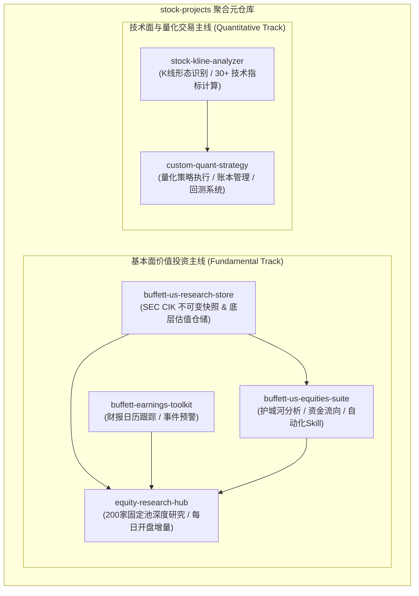

# Stock Projects (美股投研与量化交易全景工程)

[](https://git-scm.com/book/en/v2/Git-Tools-Submodules)
[](#子项目矩阵)
[](#)

本项目是集中汇总美股基本面深度研究、巴菲特估值建模、事件与财报跟踪、单股技术指标计算与量化交易策略平台的**聚合元仓库 (Meta-Repository)**。

---

## 核心设计原则

- **物理隔离，互不混编**：采用 **Git Submodules** 架构，将各个子系统保持为独立的 Git 仓库。
- **保留完整历史**：每个子项目均完整保留各自的 Git 提交历史、标签、分支及原生远程链接，不交叉合并业务逻辑。
- **全局统一视图**：在顶层提供整体索引、协同架构拓扑、统一克隆与更新入口。

---

## 子项目矩阵

| 模块目录 | 领域分类 | 对应独立仓库 | 核心功能与职责 |
| :--- | :--- | :--- | :--- |
| **`equity-research-hub`** | 基本面投研 | [minglu-lin/equity-research-hub](https://github.com/minglu-lin/equity-research-hub) | 来源可追溯的美股投研底稿库、200 家固定科技池跟踪、估值证据链与每日开盘增量数据库。 |
| **`buffett-us-research-store`** | 估值数据仓储 | [minglu-lin/buffett-us-research-store](https://github.com/minglu-lin/buffett-us-research-store) | 严格基于 SEC CIK 权威主键的不可变估值数据快照（涵盖 376+ 美股底线数据、Owner Earnings 与确定性折现模型）。 |
| **`buffett-us-equities-suite`** | 估值分析套件 | [minglu-lin/buffett-us-equities-suite](https://github.com/minglu-lin/buffett-us-equities-suite) | 整合巴菲特商业护城河分析、现行市场实时数据抓取与美股资金流向（Market Flows）的三合一 Agent/Skill 套件。 |
| **`buffett-earnings-toolkit`** | 事件与财报跟踪 | [minglu-lin/buffett-earnings-toolkit](https://github.com/minglu-lin/buffett-earnings-toolkit) | 财报日历跟踪、发布倒计时、公司池自选监视与轻量级分析预警流水线。 |
| **`stock-kline-analyzer`** | 技术面特征工程 | [minglu-lin/stock-kline-analyzer](https://github.com/minglu-lin/stock-kline-analyzer) | 经过验证的量化单股 K 线形态识别与 30+ 维数值型技术指标（均线、动量、波动率等）计算 Skill。 |
| **`custom-quant-strategy`** | 实盘与量化策略 | [minglu-lin/custom-quant-strategy](https://github.com/minglu-lin/custom-quant-strategy) | 模块化量化交易策略平台，集成回测、订单执行、持仓账本及 K 线形态技术面共振策略。 |

---

## 体系架构拓扑



---

## 快速上手与操作指南

### 1. 完整克隆主仓库及所有子项目

首次克隆时使用 `--recurse-submodules` 递归下载全部子模块：

```bash
git clone --recurse-submodules https://github.com/minglu-lin/stock-projects.git
cd stock-projects
```

若已普通克隆，可执行以下命令拉取并初始化子模块：

```bash
git submodule update --init --recursive
```

### 2. 同步与更新子模块

拉取各子项目远程主分支的最新改动：

```bash
git submodule update --remote --merge
```

### 3. 子项目独立开发与提交流程

在子项目目录中修改代码后，在子目录中独立提交并推送至各自的 GitHub 仓库：

```bash
# 进入具体子项目开发
cd custom-quant-strategy
git checkout main
# ... 编辑代码 ...
git add .
git commit -m "feat: optimize trend momentum strategy logic"
git push origin main

# 返回主仓库，提交指针更新
cd ..
git add custom-quant-strategy
git commit -m "chore: bump custom-quant-strategy pointer"
git push origin main
```

---

## 目录结构

```text
stock-projects/
├── .gitmodules                 # 子模块配置（包含 6 个独立项目的 GitHub 映射）
├── .gitignore
├── README.md                   # 全局索引与架构文档
├── equity-research-hub/        # [Submodule] 美股综合研究中心
├── buffett-us-research-store/  # [Submodule] 巴菲特美股估值数据仓储
├── buffett-us-equities-suite/  # [Submodule] 巴菲特美股研究分析套件
├── buffett-earnings-toolkit/   # [Submodule] 美股财报日历与工具箱
├── stock-kline-analyzer/       # [Submodule] K线技术指标分析 Skill
└── custom-quant-strategy/      # [Submodule] 定制量化交易策略平台
```
